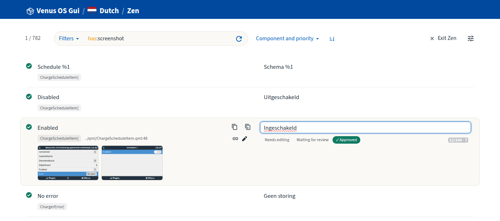
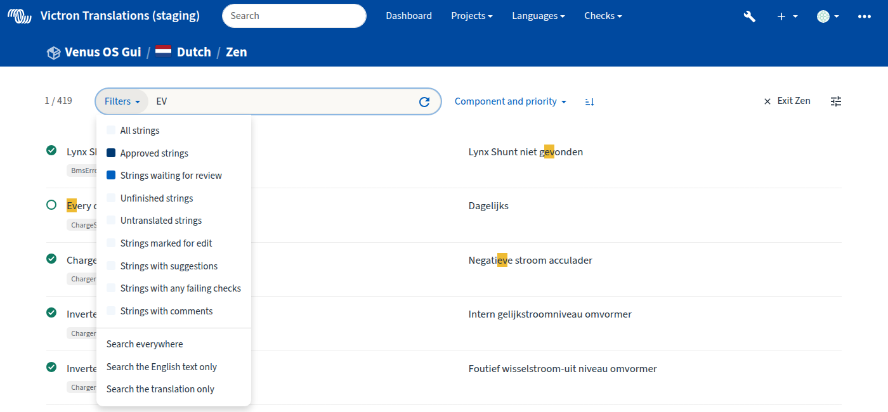

# Weblate customizations from Victron Energy

These are the customizations Victron Energy runs on its self-hosted Weblate (2026.10.1.4). They are shared so that
ideas worth having in Weblate itself can be taken upstream (see WeblateOrg/weblate#22916). This is a snapshot, not a
maintained project.

## Wiring

```yaml
# docker-compose.yml, service weblate
volumes:
  - ./customize:/app/data/python/customize/static:ro
  - ./customize-app/apps.py:/app/data/python/customize/apps.py:ro
```

```sh
# environment
WEBLATE_EXTRA_HTML_HEAD=<link rel="stylesheet" href="/static/victron.css"><script src="/static/victron.js" defer></script>
```

`victron.css` imports a generated `flags.css` (language flags) that this snapshot leaves out, along with the logos.
Without it, the import fails and nothing else changes.

Tests: `node --test 'tests/*.test.js'`

## What it changes

For translators who come from a simpler tool (POEditor), aiming for a calmer interface:

- **Lists as tiles** (`victron.js` + CSS): project, component and language lists, and a translation's string status
  table, become tiles with the progress bar inside, tinted on hover. Without the script, the tables stay as they are.
- **Calmer translate page**: fewer columns, no admin alert icons, only previous and next for navigation, a larger
  source text and translation field, quiet special-character buttons. Plural forms keep their length and keep their
  tools under their own field.
- **Zen mode as a list to scan and edit**: in both layouts, a list of plain texts with the context below them; a
  translation becomes a field when clicked. With a search (e.g. "EV"), you see about ten strings per screen.
  - Screenshots of the string being edited are shown in Zen.
  - An empty translation shows its translation memory matches; a copied match is marked as needing editing, as in
    the full editor.

  

- **Search shows why a string matches**: a plain word also matches the translation, but Weblate highlights matches
  only in the source, so the script highlights them in the translation too (CSS Custom Highlight API). The Filters
  menu gets "everywhere / source only / translation only" entries, which rewrite the query with `source:` or
  `target:`. These keep `state:` terms, date ranges, quoted values and URLs intact.

  

- **Hides "Read-only strings"** on the language page, because it leads to an empty list (#22916).
- **Dark mode** follows Weblate's own theme setting as well as the system one; muted text meets AA contrast.
- **Defaults for new users** (`customize-app/apps.py`, Weblate has no setting for these):
  - Zen side by side as the translation editor mode.
  - New users watch every project they can see, so their dashboard isn't empty before their first translation.

## Licence

GPL-3.0-or-later, as Weblate. See `LICENSE`.
